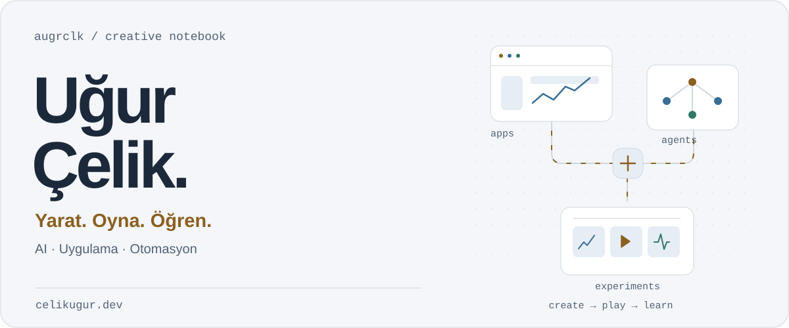
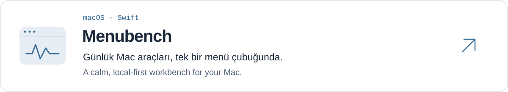
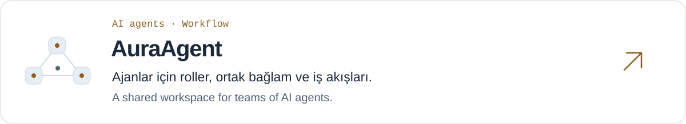
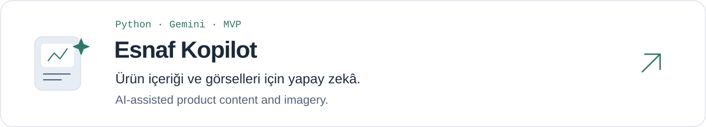

<a href="https://www.celikugur.dev/">
<picture>
  <source media="(prefers-color-scheme: dark) and (max-width: 600px)" srcset="assets/hero-dark-mobile.svg">
  <source media="(max-width: 600px)" srcset="assets/hero-light-mobile.svg">
  <source media="(prefers-color-scheme: dark)" srcset="assets/hero-dark.svg">
  
</picture>
</a>

  <a href="https://www.celikugur.dev/"><strong>Portfolyo ↗</strong></a>
  &nbsp;&nbsp;·&nbsp;&nbsp;
  <a href="https://www.linkedin.com/in/augrclk/"><strong>LinkedIn ↗</strong></a>
  &nbsp;&nbsp;·&nbsp;&nbsp;
  <a href="mailto:augrclk@gmail.com"><strong>Bir merhaba ↗</strong></a>

 

<strong>Yapay Zeka Destekli İçerik Ve Ürün Geliştiricisi - Yazılım Mühendisliği Öğrencisi.</strong>

AI-assisted Content &amp; Product Developer · Software Engineering Student

 

### Projeler · Selected work

<a href="https://github.com/augrclk/menubench">
<picture>
  <source media="(prefers-color-scheme: dark) and (max-width: 600px)" srcset="assets/menubench-dark-mobile.svg">
  <source media="(max-width: 600px)" srcset="assets/menubench-light-mobile.svg">
  <source media="(prefers-color-scheme: dark)" srcset="assets/menubench-dark.svg">
  
</picture>
</a>

 

<a href="https://github.com/augrclk/AuraAgent-Framework">
<picture>
  <source media="(prefers-color-scheme: dark) and (max-width: 600px)" srcset="assets/auraagent-dark-mobile.svg">
  <source media="(max-width: 600px)" srcset="assets/auraagent-light-mobile.svg">
  <source media="(prefers-color-scheme: dark)" srcset="assets/auraagent-dark.svg">
  
</picture>
</a>

 

<a href="https://github.com/augrclk/Esnaf-Kopilot">
<picture>
  <source media="(prefers-color-scheme: dark) and (max-width: 600px)" srcset="assets/esnaf-kopilot-dark-mobile.svg">
  <source media="(max-width: 600px)" srcset="assets/esnaf-kopilot-light-mobile.svg">
  <source media="(prefers-color-scheme: dark)" srcset="assets/esnaf-kopilot-dark.svg">
  
</picture>
</a>

 

<strong>Diğer deneyler · More experiments</strong>

 

- **[GuessAI](https://github.com/augrclk/GuessAI)** — Karar ağaçlarıyla aklındaki nesneyi tahmin eden bir oyun.
- **[Manga Script](https://github.com/augrclk/Manga-Script)** — Görsel, ses ve videoyu bir araya getiren manga üretim akışı.
- **[Hikmet Atölyesi](https://github.com/augrclk/HikmetAtolyesi)** — Sosyalfest 2026 için geliştirilmiş bir proje.

 

---

  <strong>Üret. Oyna. Öğren.</strong>  
  <a href="https://www.celikugur.dev/#lab">Diğer çalışmalarımı keşfet ↗</a>

